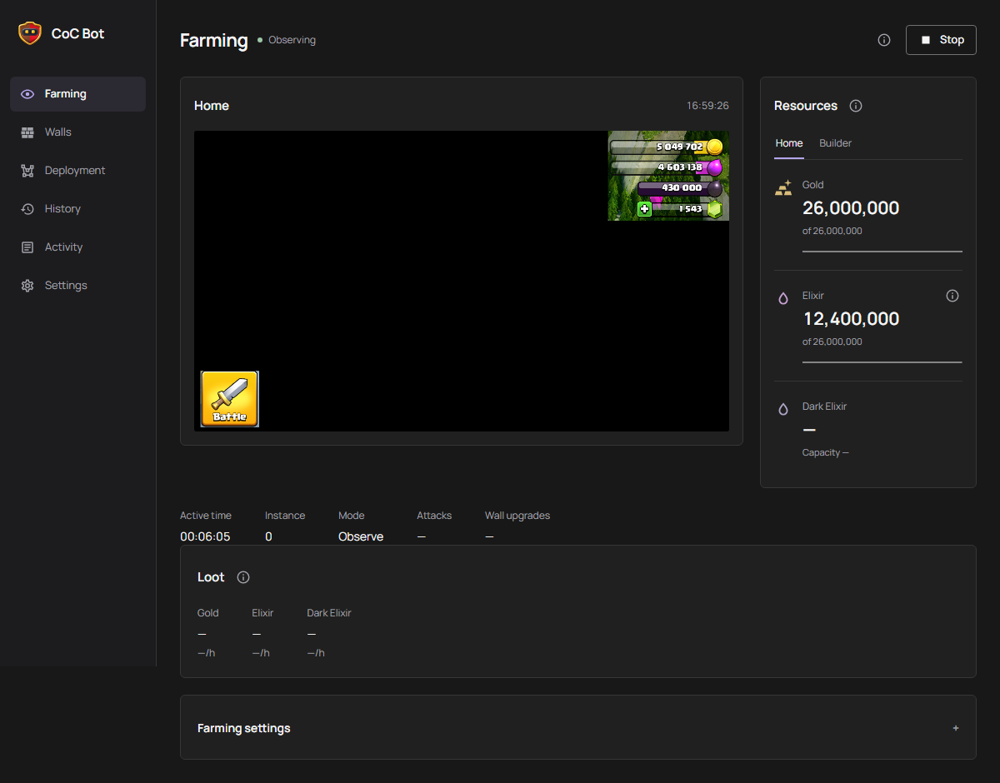

  

<h1 align="center">CoC Bot</h1>

Clash of Clans automation for Windows and LDPlayer, built in Rust.

  
  

## Get started

Development builds include Home and Builder farming,
dynamic army deployment, wall upgrades and bounded recovery, with a Tauri/React dashboard
for controls, deployment editing, resources and SQLite session history. Observe mode sends
no game input. Automated validation uses captured screenshots and fake devices; live
gameplay compatibility is unverified and uncaptured English screens remain pending.
There is no public desktop release yet. The runtime is entirely Rust, with no Python
installation or sidecar required.

The original [Python guide](LEGACY.md) is retained for reference, including its upstream
links. The Python bot and old dashboard are preserved in Git history at `a3b3346`;
their hosted relay is not part of the desktop app. Build instructions and offline
checks are in [CONTRIBUTING.md](CONTRIBUTING.md).

> [!IMPORTANT]
> Calibration targets LDPlayer at 1280×720, DPI 240, with the game in English.
> Other resolutions or languages are unsupported. Automation violates
> Supercell's rules and can result in an account ban. Not affiliated with Supercell.

Default wall settings retain 20M gold **and** elixir batching and 1M reserves.
The current Home price calibration in the [English profile](assets/config.json)
targets green Hammer Jam discounts; revalidate it when that event ends. Screens not
yet captured in English are listed in `calibration_pending_screens`; an unfamiliar
dialog fails recognition and cannot be confirmed automatically. Pending screens have
no templates; the Indonesian calibration has been removed.
Both Builder stages have offline deployment regressions. Live validation is still needed
before relying on unattended farming or wall upgrades.

## Contributing

Read [CONTRIBUTING.md](CONTRIBUTING.md) for development, conventional commits and PR review.
Report problems through [GitHub issues](https://github.com/ohne-b/coc-bot/issues), with
redacted logs and your commit, emulator version, resolution and game language.
See [SECURITY.md](SECURITY.md) for private vulnerability reports.

The desktop UI and calibration are English only.

## License and credits

Original contributions by ohne-b (OhneB) use [PolyForm Noncommercial 1.0.0](LICENSE.md).
This is source-available work for noncommercial use. Keep its license and required notices.

Based on [peenjeee/coc-auto](https://github.com/peenjeee/coc-auto) and its contributors.
**The imported upstream revision has no project license.** PolyForm does not relicense
that code or grant permission to use, modify or redistribute it. See [NOTICE.md](NOTICE.md)
for the exact baseline, license scope and retained third-party notices.
